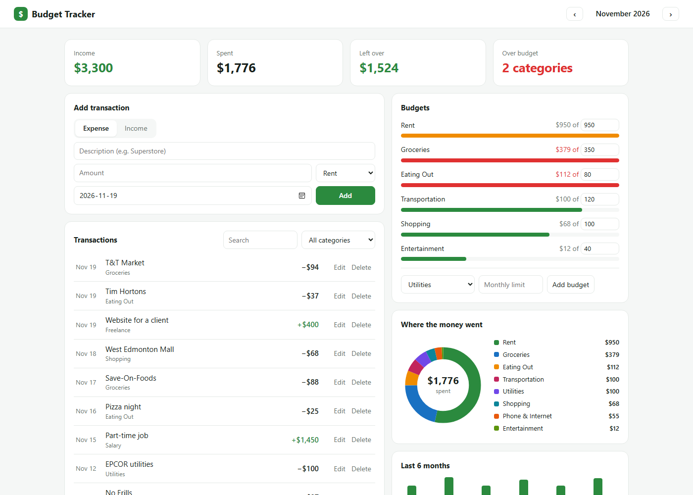

# Budget Tracker

[](https://github.com/shucab-lane/budget-tracker/actions/workflows/ci-cd.yml)

A personal budgeting app built with **C#** and **Blazor WebAssembly**. Track income and spending, set monthly budgets per category, and see where your money goes.

**Live demo: https://shucab-lane.github.io/budget-tracker/** (loads with sample data)



## Features

- Add, edit and delete income and expenses
- Monthly budgets per category with progress bars that turn orange near the limit and red when you go over
- Spending breakdown chart and a 6-month income vs. spending history
- Search and filter transactions, and move between months
- Export a month to CSV
- Data is saved in the browser (localStorage), so there's no sign-up

## Built with

- **C# / .NET 10** with **Blazor WebAssembly**: the whole app runs in the browser
- **LINQ** for the monthly summaries, category totals and search
- **xUnit**: 11 unit tests for the budgeting logic
- **GitHub Actions**: runs the tests and deploys to GitHub Pages on every push

## Project structure

```
src/BudgetTracker.Core    models and BudgetService (all the logic, no UI)
src/BudgetTracker.Web     Blazor pages, styles, localStorage persistence
tests/BudgetTracker.Tests xUnit tests
```

## Run it locally

```bash
dotnet test
dotnet run --project src/BudgetTracker.Web
```
